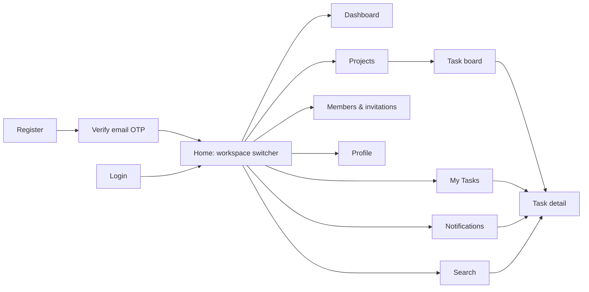
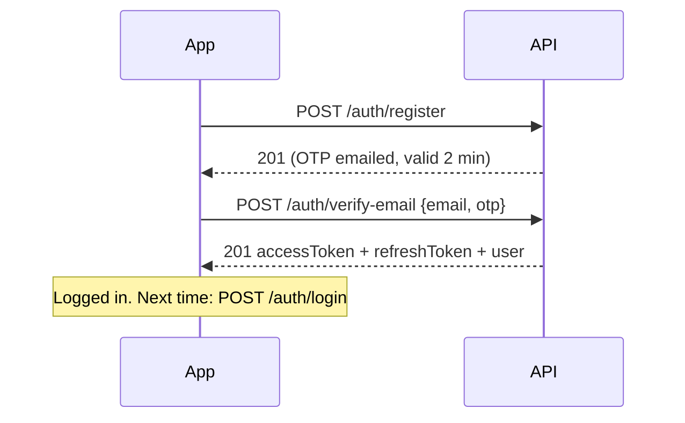

# Taskify API: a screen-by-screen guide

How the app works, which API each screen calls, and what comes back. Written for building the mobile app (or any other client): pick a screen, read its section, and you know what to request and what to show.

- Business rules and user journeys: [WORKFLOW.md](WORKFLOW.md)
- Collections and relationships: [DATA_MODEL.md](DATA_MODEL.md)
- Every field of every endpoint, try it live: Swagger at **`<server>/api`**

---

## Contents

1. [The basics](#1-the-basics)
2. [Demo logins](#2-demo-logins-development-only)
3. [How the app fits together](#3-how-the-app-fits-together)
4. [Screens](#4-screens)
   - [Auth](#41-auth-register--verify--login) · [Workspaces](#42-workspace-switcher--home) · [Dashboard](#43-dashboard) · [Projects](#44-projects) · [Task board](#45-task-board--task-list) · [Task detail](#46-task-detail) · [My Tasks](#47-my-tasks) · [Labels](#48-labels) · [Members & invitations](#49-members--invitations) · [My invitations](#410-my-invitations-invitee-side) · [Notifications](#411-notifications) · [Search](#412-search) · [Activity](#413-activity-feed) · [Profile](#414-profile--account) · [AI task breakdown](#415-ai-task-breakdown) · [Platform admin](#416-platform-admin)
5. [Realtime updates](#5-realtime-updates)
6. [Showing and hiding buttons (permissions)](#6-showing-and-hiding-buttons-permissions)
7. [Enums](#7-enums)
8. [Errors and status codes](#8-errors-and-status-codes)
9. [Every route at a glance](#9-every-route-at-a-glance)

---

## 1. The basics

| Topic | How it works |
|---|---|
| Base URL | Local: `http://localhost:3000`. On a phone, use the **Network** address shown on the landing page (`GET /`), e.g. `http://192.168.1.108:3000`. Hosted: `https://taskify-nest.onrender.com`. |
| Auth header | `Authorization: Bearer <accessToken>` on every route except register, login, verify, resend OTP, forgot/reset password, refresh, logout and health. |
| Tokens | `accessToken` lasts **1 hour**, `refreshToken` **7 days**. A refresh token works **once**: `POST /auth/refresh` returns a new pair. |
| Ids | MongoDB ObjectIds, 24 hex characters. A malformed id answers `400`. |
| Dates | ISO 8601 strings in UTC (`2026-10-15T17:00:00.000Z`). Show them in the device's timezone. |
| Not yours = not found | A workspace, project or task you can't access answers **404**, not 403, so it never reveals that it exists. |
| Request bodies | Unknown fields are rejected with `400`. Send only the documented fields. |

**Paginated lists** take `?page=1&limit=20` (max 100) and always return:

```json
{
  "items": [ … ],
  "meta": { "page": 1, "limit": 20, "total": 57, "totalPages": 3 }
}
```

**"Today" depends on the timezone.** Endpoints that filter by today (dashboard, My Tasks) take `tzOffset`, in minutes, as JavaScript's `getTimezoneOffset()` returns it. Nepal (UTC+5:45) is `-345`. In Flutter: `-DateTime.now().timeZoneOffset.inMinutes`.

**A user, wherever one is embedded** (assignee, author, actor, member), has this shape:

```json
{ "_id": "…", "firstName": "Dave", "lastName": "Dev", "userName": "dave", "email": "dave@taskify.dev", "avatar": null }
```

---

## 2. Demo logins (development only)

After `npm run db:reset-dev` (see [DATA_MODEL.md §8](DATA_MODEL.md#8-changing-the-schema)) these accounts exist. **Development data only. Never use these in production.**

| Email | Password | In "Acme Inc" | Good for testing |
|---|---|---|---|
| alice@taskify.dev | `Password@123` | OWNER (also platform ADMIN) | Everything, admin screens |
| bob@taskify.dev | `Password@123` | ADMIN | Members, invitations |
| carol@taskify.dev | `Password@123` | MANAGER | Projects, labels, deleting tasks |
| dave@taskify.dev | `Password@123` | MEMBER | Day-to-day task work |
| erin@taskify.dev | `Password@123` | VIEWER | Read-only views, commenting |

Each user also has a **Personal** workspace. Seed content: projects "Website Relaunch" and "Mobile App" (Acme), "Errands" (Bob's personal), 7 tasks with subtasks, labels, a dependency, comments, notifications and a pending invitation to `frank@taskify.dev`.

Passwords are stored only as bcrypt hashes. The password above is written here, not in the database.

---

## 3. How the app fits together



The data hierarchy your screens follow:

```
User
 └─ Workspaces (Personal + organizations), each with my role
     ├─ Members, Invitations, Labels, Activity, Dashboard
     └─ Projects
         └─ Tasks ── Subtasks, Comments (+ replies), Attachments, Dependencies, History
```

- **Every user has a Personal workspace** that only they can use. Teams work in **Organization** workspaces.
- **Roles are per workspace.** The same person can be OWNER in their own workspace and VIEWER in someone else's.
- **MANAGER and above see every project** in a workspace. MEMBER and VIEWER see only the projects they were added to.

---

## 4. Screens

### 4.1 Auth: register → verify → login



| Action | Request | Response |
|---|---|---|
| Register | `POST /auth/register` `{firstName, lastName, email, userName, password, dob?, gender?, bio?, phone?, avatar?}` | `201 {success, message, data: user}`. A 6-digit OTP is emailed. |
| Verify email | `POST /auth/verify-email` `{email, otp}` | `201 {accessToken, refreshToken, user}`: the user is now logged in |
| Resend OTP | `POST /auth/resend-otp` `{email}` | `201` |
| Login | `POST /auth/login` `{email, password}` | `201 {accessToken, refreshToken, user, timestamp}` |
| Refresh | `POST /auth/refresh` `{token: refreshToken}` | `201 {accessToken, refreshToken}`. Store **both** new tokens. |
| Logout | `POST /auth/logout` `{token: refreshToken}` | `201` |
| Forgot password | `POST /auth/forgot-password` `{email}` | `201`. An OTP is emailed (valid 5 min). |
| Reset password | `POST /auth/reset-password` `{email, otp, newPassword}` | `201` |

UI notes:

- Login is by **email**, not username.
- `401 Invalid credentials` means the email or the password is wrong. `403 Please verify your email first` means show the OTP screen. `403 This account has been deactivated` means show a contact-support message.
- Username: 3–30 characters of `a-z 0-9 _ .`, stored lowercase. `409` means the email or username is taken.
- Credential endpoints allow **10 requests per minute**; more answers `429`.
- When a request returns `401`, call refresh once, then retry. If refresh fails, go to login.

### 4.2 Workspace switcher / home

`GET /workspaces` (not paginated; personal workspace first):

```json
[
  {
    "_id": "…", "name": "Personal", "type": "PERSONAL", "owner": "…",
    "role": "OWNER", "title": null, "memberCount": 1,
    "permissions": ["workspace:read", "project:create", "task:create", "…"]
  },
  {
    "_id": "…", "name": "Acme Inc", "type": "ORGANIZATION",
    "role": "MEMBER", "title": "Developer", "memberCount": 5,
    "permissions": ["workspace:read", "task:create", "task:update", "…"]
  }
]
```

| Action | Call | Who |
|---|---|---|
| Create a team workspace | `POST /workspaces` `{name, description?, avatar?}` | anyone (becomes OWNER) |
| Workspace details | `GET /workspaces/:id` | members |
| Edit | `PATCH /workspaces/:id` | `workspace:update` |
| Delete (organizations only) | `DELETE /workspaces/:id` | OWNER |

**Use `permissions` to decide which buttons to show** (§6). Keep the selected workspace id in app state: almost every other screen needs it.

### 4.3 Dashboard

`GET /workspaces/:id/dashboard?tzOffset=-345`

```json
{
  "summary": { "total": 12, "completed": 4, "inProgress": 3, "overdue": 2, "dueToday": 1 },
  "byStatus": { "TODO": 4, "IN_PROGRESS": 3, "IN_REVIEW": 1, "BLOCKED": 0, "DONE": 4 },
  "openByPriority": { "URGENT": 1, "HIGH": 2, "MEDIUM": 4, "LOW": 1 },
  "projects": [ { "_id": "…", "name": "Website Relaunch", "status": "ACTIVE", "dueDate": "…",
                  "progress": { "total": 5, "completed": 2, "percent": 40 } } ],
  "workload": [ { "user": { "firstName": "Dave", "…": "…" }, "open": 3, "overdue": 1 } ]
}
```

Counts cover only the projects the caller can see. `summary`, `byStatus` and project progress count top-level tasks; `workload` counts every open assigned task, subtasks included.

Ideas for the screen: summary cards, a status donut, priority bars, project progress rows, and a team workload list.

### 4.4 Projects

| Action | Call | Who |
|---|---|---|
| List | `GET /workspaces/:id/projects?status=&search=&page=` (paginated) | members; MEMBER/VIEWER see only their projects |
| Create | `POST /workspaces/:id/projects` `{name, description?, status?, startDate?, dueDate?}` | `project:create` (MANAGER+) |
| Detail | `GET /projects/:id` | anyone who can see it |
| Edit | `PATCH /projects/:id`. Send `null` to clear a date. | `project:update` |
| Delete | `DELETE /projects/:id` → `204` | `project:delete` (ADMIN+) |
| Members | `GET /projects/:id/members` | anyone who can see it |
| Add member | `POST /projects/:id/members` `{userId}` (must be a workspace member) | `project:manage_members` |
| Remove member / leave | `DELETE /projects/:id/members/:userId` (your own id = leave) | manager, or yourself |

Every project in a response carries `progress: {total, completed, percent}`, ready for a progress bar.

### 4.5 Task board / task list

`GET /projects/:id/tasks`, paginated. Filters you can combine:

| Query | Example | Meaning |
|---|---|---|
| `status` | `TODO,IN_PROGRESS` | One column, or several |
| `priority` | `URGENT,HIGH` | |
| `assigneeId` | user id, `me`, or `none` | |
| `labelId` | label id | |
| `search` | `login` | Title or description contains |
| `dueFrom` / `dueTo` | ISO dates | |
| `includeSubtasks` | `true` | Default: top-level tasks only |
| `parentTaskId` | task id | Only that task's subtasks |
| `sort` / `order` | `position` `dueDate` `createdAt` `updatedAt` `title` / `asc` `desc` | Default `position asc` |

A task in any response:

```json
{
  "_id": "…", "workspace": "…", "project": "…", "parentTask": null,
  "title": "Fix contact form", "description": "",
  "status": "TODO", "priority": "URGENT",
  "assignees": [ { "_id": "…", "firstName": "Carol", "…": "…" } ],
  "labels": [ { "_id": "…", "name": "Bug", "color": "#dc2626" } ],
  "startDate": null, "dueDate": "2026-10-12T09:00:00.000Z", "completedAt": null,
  "estimatedHours": null, "position": 2,
  "subtaskProgress": { "total": 2, "completed": 1, "percent": 50 },
  "createdAt": "…", "updatedAt": "…"
}
```

| Action | Call | Who |
|---|---|---|
| Create | `POST /projects/:id/tasks` `{title, description?, status?, priority?, assigneeIds?, labelIds?, startDate?, dueDate?, estimatedHours?, position?, parentTaskId?}` | `task:create` (MEMBER+) |
| Move on the board | `PATCH /tasks/:id` `{status, position}` | `task:update` |
| Delete (with subtasks) | `DELETE /tasks/:id` → `204` | `task:delete` (MANAGER+) |

Board tips: one column per status (`?status=TODO` and so on), or load all and group on the client. To reorder within a column, send a `position` between those of the neighbouring cards. Assignees must be able to see the project (otherwise `400`); labels must belong to the same workspace.

### 4.6 Task detail

One screen, several small calls:

| Section | Call | Response |
|---|---|---|
| Header | `GET /tasks/:id` | The task, plus `createdBy` |
| Edit any field | `PATCH /tasks/:id` `{title?, status?, priority?, assigneeIds?, labelIds?, dueDate?, …}` | Updated task. `assigneeIds: []` unassigns everyone; changing assignees needs `task:assign`. |
| Subtasks | `GET /tasks/:id/subtasks`, create with `POST /projects/:pid/tasks` `{title, parentTaskId}` | Task array. Subtasks can't have subtasks. |
| Comments | `GET /tasks/:id/comments` (paginated) | Threads: each comment has `replies[]` and `author` |
| Add comment / reply | `POST /tasks/:id/comments` `{content, parentCommentId?}` | `@username` in the text notifies that person (if they can see the task) |
| Edit / delete comment | `PATCH /comments/:id` `{content}` · `DELETE /comments/:id` | Author, or `comment:moderate` (MANAGER+). Delete also removes replies. |
| Attachments | `GET /tasks/:id/attachments` | `{_id, fileName, mimeType, size, uploadedBy, createdAt}` |
| Upload | `POST /tasks/:id/attachments`, multipart field `file` | Max 20 MB; images, PDF, txt, csv, zip, Office files |
| Download | `GET /attachments/:id/download` with the auth header | The file (`Content-Disposition: attachment`) |
| Delete file | `DELETE /attachments/:id` | Uploader, or `attachment:moderate` |
| Dependencies | `GET /tasks/:id/dependencies` | `{blockedBy: [{dependencyId, task}], blocking: [...], isBlocked}` |
| Add "blocked by" | `POST /tasks/:id/dependencies` `{blockedByTaskId}` | Same project only; cycles are rejected (`400`) |
| Remove dependency | `DELETE /tasks/:id/dependencies/:dependencyId` | |
| History | `GET /tasks/:id/activity` (paginated) | e.g. `{action: "task.updated", actor, metadata: {changes: {status: {from: "TODO", to: "DONE"}}}}` |

Show a "Blocked" badge when `isBlocked` is true: something it depends on isn't DONE yet.

### 4.7 My Tasks

`GET /users/me/tasks?view=today&tzOffset=-345` (paginated): tasks assigned to me in every workspace I can still access.

| `view` | Shows |
|---|---|
| `all` (default) | Everything open |
| `today` | Open, due today |
| `upcoming` | Open, due after today |
| `overdue` | Open, due before today |
| `completed` | DONE, newest first |

Optional filters: `workspaceId`, `projectId`, `priority`. Each task also has `project: {_id, name}` and `workspace: {_id, name, type}`, so you can show where it lives.

### 4.8 Labels

Labels belong to a workspace and work in all its projects. Names are unique, ignoring case.

| Action | Call | Who |
|---|---|---|
| List | `GET /workspaces/:id/labels` → `[{_id, name, color}]` | members |
| Create | `POST /workspaces/:id/labels` `{name, color?: "#2563eb"}` | `label:manage` (MANAGER+) |
| Edit | `PATCH /labels/:id` | `label:manage` |
| Delete (removed from all tasks) | `DELETE /labels/:id` | `label:manage` |

### 4.9 Members & invitations

| Action | Call | Who |
|---|---|---|
| Members | `GET /workspaces/:id/members?search=&role=` (paginated) → `{_id, user, role, title, status, joinedAt}` | members |
| Change role / title / suspend | `PATCH /workspaces/:id/members/:userId` `{role?, title?, status?}` | `member:update`, only for people ranked below you |
| Remove / leave | `DELETE /workspaces/:id/members/:userId` (your own id = leave; the OWNER can't leave) | `member:remove`, or yourself |
| Find people to invite | `GET /workspaces/:id/invitations/candidates?q=ram` → top 5 users, each with `inviteStatus: AVAILABLE \| INVITED \| MEMBER` | `member:invite` (ADMIN+) |
| Invite | `POST /workspaces/:id/invitations` `{email \| userName, role}` | `member:invite`; the role must rank below yours |
| Invitations sent | `GET /workspaces/:id/invitations?status=PENDING` (paginated) | `member:invite` |
| Cancel | `DELETE /workspaces/:id/invitations/:invitationId` | `member:invite` |

Notes:

- Personal workspaces have no members or invitations (`400`).
- Invitations last 7 days. Someone without an account can be invited by email; they see the invitation once they register with that email.
- Suspended members keep their data but lose access. To bring one back, set `status: ACTIVE` (re-inviting them is rejected).
- Removing a member takes them out of all projects and unassigns their unfinished tasks.

### 4.10 My invitations (invitee side)

| Action | Call |
|---|---|
| List | `GET /invitations` → pending invitations to my email, with `workspace {name, avatar, type}` and `invitedBy` |
| Accept | `POST /invitations/:id/accept` → the new membership; the workspace now appears in `GET /workspaces` |
| Decline | `POST /invitations/:id/decline` → `204` |

`410` means the invitation expired or the workspace is gone; `409` means it was already answered.

### 4.11 Notifications

| Action | Call |
|---|---|
| Badge count | `GET /notifications/unread-count` → `{count}` |
| List | `GET /notifications?unreadOnly=true` (paginated) |
| Mark read | `PATCH /notifications/:id/read` |
| Mark all read | `PATCH /notifications/read-all` |
| Delete one / clear | `DELETE /notifications/:id` · `DELETE /notifications?readOnly=true` |

```json
{
  "_id": "…", "type": "TASK_ASSIGNED", "message": "You were assigned \"Fix contact form\"",
  "actor": { "firstName": "Carol", "…": "…" }, "workspace": "…",
  "entityType": "task", "entityId": "…", "link": "/tasks/…", "readAt": null, "createdAt": "…"
}
```

On tap, open `link`: `/tasks/:id` goes to task detail, `/projects/:id` to the project, `/invitations` to my invitations. Notification types are listed in §7. You only get notifications about projects you can currently see.

### 4.12 Search

`GET /search?q=login&types=tasks,projects&workspaceId=&limit=10`. `q` needs at least 2 characters.

```json
{ "tasks": [ … ], "projects": [ … ], "users": [ … ], "comments": [ … ] }
```

Results only come from projects and people you can access. People search finds only people who share a workspace with you.

### 4.13 Activity feed

| Feed | Call |
|---|---|
| Workspace | `GET /workspaces/:id/activity` |
| Project | `GET /projects/:id/activity` |
| Task history | `GET /tasks/:id/activity` |

All are paginated, newest first:

```json
{ "action": "task.updated", "entityType": "task", "entityId": "…", "actor": { "…": "…" },
  "metadata": { "title": "…", "changes": { "status": { "from": "TODO", "to": "IN_PROGRESS" } } },
  "createdAt": "…" }
```

Turn `action` into a sentence, e.g. "Dave moved *Fix contact form* from TODO to IN_PROGRESS". The action names are listed in §5.

### 4.14 Profile & account

| Action | Call |
|---|---|
| Me | `GET /users/me` |
| Edit profile | `PUT /auth/profile` `{dob?, gender?, bio?, phone?, avatar?}`. `avatar` must be an `https://` URL or the current value unchanged. |
| Upload photo | `POST /users/me/avatar`, multipart field `file` (jpeg/png/webp/gif, ≤ 5 MB) |
| Remove photo | `DELETE /users/me/avatar` |
| Show a photo | If `avatar` starts with `https://`, load that URL. Otherwise load `GET /users/:id/avatar` **with the auth header**. |
| Someone's public profile | `GET /users/:id` |
| Change password | `POST /auth/change-password` `{currentPassword, newPassword}` |
| Delete my account | `DELETE /auth/account` |

### 4.15 AI task breakdown

| Step | Call |
|---|---|
| 1. Get suggestions (nothing saved) | `POST /projects/:id/ai/task-breakdown` `{goal}` → `{tasks: [{title, description, priority, subtasks: [{title}]}]}` |
| 2. Let the user tick or edit them, then save | `POST /projects/:id/ai/task-breakdown/apply` `{tasks: [...]}` → created tasks |

Needs `task:create`. The goal is 5–1000 characters.

### 4.16 Platform admin

Only for accounts with platform role `ADMIN` (`user.role` in the login response). This is separate from workspace roles.

| Action | Call |
|---|---|
| All users | `GET /users?search=&role=&isActive=&page=&limit=` → `{items, total, page, limit}` |
| Edit user | `PUT /users/:id` `{email?, userName?, role?, avatar?, isActive?}` |
| Deactivate / activate | `PATCH /users/:id/deactivate` · `PATCH /users/:id/activate` |
| Soft delete | `PATCH /users/:id/delete` |

---

## 5. Realtime updates

Socket.IO, namespace **`/realtime`**. Payloads contain only ids: on an event, **refetch through REST**.

```dart
final socket = io('$baseUrl/realtime', OptionBuilder()
    .setTransports(['websocket'])
    .setAuth({'token': accessToken})
    .build());
socket.emitWithAck('subscribe', {'projectId': projectId});  // or {'workspaceId': id}
```

Make sure the URL has exactly one slash before `realtime`.

| Event you receive | Payload | What to do |
|---|---|---|
| `event` | `{type, workspaceId, projectId, taskId, entityId, actorId}` | Refetch whatever shows that entity |
| `notification` | `{notificationId}` | Bump the badge, refetch the list |
| `invitation` | `{type, invitationId, workspaceId}` | Refetch `GET /invitations` |
| `disconnect` | | Access changed (removed, suspended, role changed) or the token expired: reconnect with a fresh token and subscribe again |

`subscribe` answers `{ok: true}` or `{ok: false, error}`. Project events go to the project room; workspace-level events (members, invitations, labels) go to the workspace room.

Event `type` values: `task.created|updated|deleted`, `comment.created|deleted`, `attachment.uploaded|deleted`, `dependency.added|removed`, `project.created|updated|deleted`, `project.member.added|removed`, `workspace.member.joined|removed|role_changed|status_changed`, `invitation.created|declined|cancelled`, `label.deleted`.

---

## 6. Showing and hiding buttons (permissions)

Each workspace from `GET /workspaces` carries `permissions`. Check those, not role names:

| Permission | VIEWER | MEMBER | MANAGER | ADMIN | OWNER | Button / screen |
|---|:-:|:-:|:-:|:-:|:-:|---|
| `workspace:read`, `member:read`, `project:read`, `task:read`, `activity:read` | ✅ | ✅ | ✅ | ✅ | ✅ | Viewing |
| `comment:create` | ✅ | ✅ | ✅ | ✅ | ✅ | Comment box |
| `task:create`, `task:update`, `task:assign`, `attachment:upload` | | ✅ | ✅ | ✅ | ✅ | New task, edit, assign, upload |
| `project:create`, `project:update`, `project:manage_members`, `project:read_all` | | | ✅ | ✅ | ✅ | New project, project settings, sees all projects |
| `task:delete`, `label:manage`, `comment:moderate`, `attachment:moderate` | | | ✅ | ✅ | ✅ | Delete task, label settings, delete others' comments and files |
| `workspace:update`, `member:invite`, `member:update`, `member:remove`, `project:delete` | | | | ✅ | ✅ | Workspace settings, invite, manage members, delete project |
| `workspace:delete` | | | | | ✅ | Delete workspace |

Also: anyone can edit or delete **their own** comments and files. You can only manage members ranked **below** you, and only grant roles below your own.

---

## 7. Enums

| Name | Values |
|---|---|
| Task status | `TODO` `IN_PROGRESS` `IN_REVIEW` `BLOCKED` `DONE` |
| Task priority | `URGENT` `HIGH` `MEDIUM` `LOW` |
| Project status | `ACTIVE` `ON_HOLD` `COMPLETED` `ARCHIVED` `CANCELLED` |
| Workspace type | `PERSONAL` `ORGANIZATION` |
| Workspace role | `OWNER` `ADMIN` `MANAGER` `MEMBER` `VIEWER` |
| Member status | `ACTIVE` `SUSPENDED` |
| Invitation status | `PENDING` `ACCEPTED` `DECLINED` `EXPIRED` `CANCELLED` |
| Notification type | `TASK_ASSIGNED` `TASK_STATUS_CHANGED` `TASK_DUE_SOON` `COMMENT_ADDED` `MENTIONED` `WORKSPACE_INVITATION` `PROJECT_MEMBER_ADDED` |
| Platform role | `ADMIN` `USER` |
| Gender | `Male` `Female` `Other` `Prefer not to say` |

---

## 8. Errors and status codes

Every error has the same shape:

```json
{ "statusCode": 400, "error": "Bad Request", "message": ["title should not be empty"] }
```

`message` is a string, or a list of validation messages.

| Code | Meaning | What the app should do |
|---|---|---|
| 200 / 201 | OK / created | |
| 204 | Done, no body (deletes) | |
| 400 | Invalid input, or a business rule (e.g. "Subtasks cannot have their own subtasks") | Show `message` |
| 401 | Missing or expired token, wrong login | Refresh once, else go to login |
| 403 | Signed in but not allowed; email not verified; account deactivated | Hide the action / show why |
| 404 | Doesn't exist **or you can't access it** | "Not found" |
| 409 | Duplicate (email, username, label name, member, pending invitation) | Show `message` |
| 410 | Invitation expired or its workspace was deleted | Remove it from the list |
| 429 | Too many requests | Wait and retry |

---

## 9. Every route at a glance

| Method | Path | Screen |
|---|---|---|
| GET | `/` | Landing page (server addresses) |
| GET | `/health` · `/health/detailed` · `/health/full` · `/health/live` · `/health/ready` | Monitoring |
| POST | `/auth/register` · `/auth/verify-email` · `/auth/resend-otp` · `/auth/login` · `/auth/refresh` · `/auth/logout` · `/auth/forgot-password` · `/auth/reset-password` | Auth |
| POST | `/auth/change-password` | Profile |
| PUT | `/auth/profile` | Profile |
| DELETE | `/auth/account` | Profile |
| GET | `/users/me` · `/users/:id` · `/users/:id/avatar` | Profile |
| POST / DELETE | `/users/me/avatar` | Profile |
| GET | `/users/me/tasks` | My Tasks |
| GET / PUT / PATCH | `/users` · `/users/:id` · `/users/:id/activate` · `/users/:id/deactivate` · `/users/:id/delete` | Platform admin |
| GET / POST | `/workspaces` | Workspace switcher |
| GET / PATCH / DELETE | `/workspaces/:id` | Workspace settings |
| GET | `/workspaces/:id/members` | Members |
| PATCH / DELETE | `/workspaces/:id/members/:userId` | Members |
| GET / POST | `/workspaces/:id/invitations` | Invitations (admin) |
| GET | `/workspaces/:id/invitations/candidates` | Invite picker |
| DELETE | `/workspaces/:id/invitations/:invitationId` | Invitations (admin) |
| GET | `/invitations` | My invitations |
| POST | `/invitations/:id/accept` · `/invitations/:id/decline` | My invitations |
| GET / POST | `/workspaces/:id/labels` | Labels |
| PATCH / DELETE | `/labels/:id` | Labels |
| GET / POST | `/workspaces/:id/projects` | Projects |
| GET / PATCH / DELETE | `/projects/:id` | Project detail |
| GET / POST | `/projects/:id/members` | Project members |
| DELETE | `/projects/:id/members/:userId` | Project members |
| GET / POST | `/projects/:id/tasks` | Task board |
| GET / PATCH / DELETE | `/tasks/:id` | Task detail |
| GET | `/tasks/:id/subtasks` | Task detail |
| GET / POST | `/tasks/:id/comments` | Task detail |
| PATCH / DELETE | `/comments/:id` | Task detail |
| GET / POST | `/tasks/:id/attachments` | Task detail |
| GET | `/attachments/:id/download` | Task detail |
| DELETE | `/attachments/:id` | Task detail |
| GET / POST | `/tasks/:id/dependencies` | Task detail |
| DELETE | `/tasks/:id/dependencies/:dependencyId` | Task detail |
| GET | `/workspaces/:id/activity` · `/projects/:id/activity` · `/tasks/:id/activity` | Activity |
| GET | `/workspaces/:id/dashboard` | Dashboard |
| GET | `/notifications` · `/notifications/unread-count` | Notifications |
| PATCH | `/notifications/read-all` · `/notifications/:id/read` | Notifications |
| DELETE | `/notifications` · `/notifications/:id` | Notifications |
| GET | `/search` | Search |
| POST | `/projects/:id/ai/task-breakdown` · `/projects/:id/ai/task-breakdown/apply` | AI breakdown |
