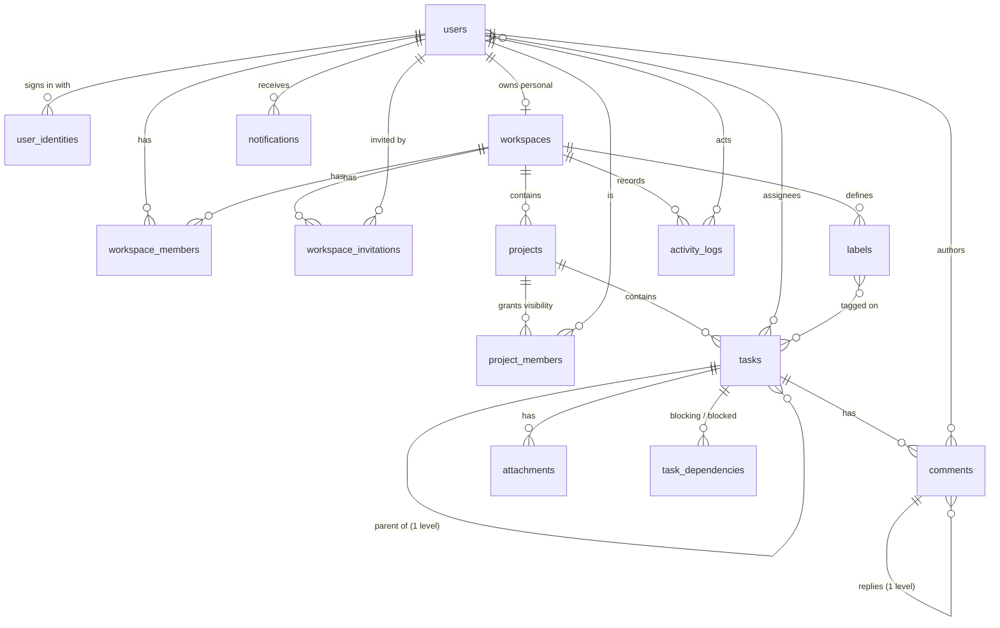

# Taskify data model

The reference for every MongoDB collection: what each one is for, who owns it, how it relates to the others, which indexes exist and why, and how documents are deleted. If you change a schema, update this file in the same PR.

Database: MongoDB **replica set** (Atlas in hosted environments, `mongodb-memory-server` replica set in tests; transactions require it). ODM: Mongoose 6 through `@nestjs/mongoose`.

---

## 1. Entity-relationship diagram



The tenant boundary is **`workspace_members`**. Every workspace-scoped read or write first resolves the caller's ACTIVE membership in the owning workspace. A user's role is stored only there, never on the user document.

Authorization chain, implemented once in `TaskAccessService` → `ProjectAccessService` → `WorkspaceAccessService`:

```
task (deletedAt null) → project (deletedAt null) → workspace (deletedAt null)
  → caller's workspace_members row (status ACTIVE)
  → project visible? (role has PROJECT_READ_ALL, or a project_members row exists)
  → role has the required permission
```

---

## 2. Conventions

| Topic | Rule |
|---|---|
| Collection names | `snake_case`, plural form of the model class: `WorkspaceMember` → `workspace_members`. Always set explicitly with `@Schema({ collection })`; never rely on Mongoose pluralization. |
| Model names | `PascalCase` singular, equal to the schema class name. |
| Field names | `camelCase`. |
| References | Named after the referenced entity, singular (`workspace`, `project`, `task`, `user`, `author`, `recipient`, `actor`, `createdBy`); arrays plural (`assignees`, `labels`, `mentions`). Always `SchemaTypes.ObjectId` with `ref`. Polymorphic references use the pair `entityType` + `entityId`. Kept without an `Id` suffix because the API returns these field names and the mobile app reads them. |
| Copied scope | A child may copy its parent's `workspace`/`project` for authorization and queries (§5). Copies are `immutable: true`, set by the server from the loaded parent, never from client input. |
| Timestamps | Every collection has `createdAt` (and `updatedAt` unless append-only) from `timestamps: true`. Moments are `<verb>At` (`deletedAt`, `completedAt`, `readAt`, `respondedAt`, `joinedAt`, `editedAt`, `expiresAt`). Calendar dates a user chooses are `<noun>Date` (`startDate`, `dueDate`). |
| Booleans | `is<Adjective>` (`isActive`, `isEmailVerified`). |
| Enums | UPPER_SNAKE string values, defined next to the schema (`TaskStatus`, `WorkspaceRole`, …). |
| Soft delete | `deletedAt: Date \| null`. Never a boolean flag. |
| Index names | Mongoose defaults (`field_1_other_-1`), declared on the schema next to the class. |
| Model registry | Every model is listed once in `src/database/models.ts`. Tooling (`db:check`, `db:reset-dev`) reads that list. |

---

## 3. Collections

Legend: **R** required, **I** immutable, **S** secret (never serialized), **U** unique.

### `users`: account identity (root)

| Field | Type | Notes |
|---|---|---|
| firstName, lastName | string R | ≤ 50 chars |
| email | string R U | Stored lowercased and trimmed |
| userName | string R U | Lowercase `[a-z0-9_.]`, 3–30 chars |
| password | string R S | bcrypt hash |
| role | `ADMIN` \| `USER` | **Platform** role only (site administration) |
| avatar | string \| null | `<UPLOAD_DIR>/avatars/<uuid>.<ext>` written by the upload endpoint, or an `https://` URL. When reading or deleting the file, only a server-generated file name inside the avatar directory is ever used. |
| bio, dob, gender, phone | optional profile fields | `dob` is `YYYY-MM-DD`. `phone` is a number for API compatibility (see §7). |
| isActive | boolean | `false` = deactivated by a platform admin. Login and refresh are refused. |
| isEmailVerified | boolean | Login requires `true` |
| emailOtp, emailOtpExpiresAt | S | Email verification |
| passwordResetOtp, passwordResetOtpExpiresAt | S | Password reset |
| refreshTokens | string[] S | Active refresh tokens (rotated on use) |
| deletedAt | Date \| null | Soft delete (account closed) |

Not stored here: workspaces, roles in workspaces, projects, tasks, notifications. All of those reference the user.

### `user_identities`: social sign-in links

| Field | Type | Notes |
|---|---|---|
| user | → users R | |
| firebaseUid | string R U | Firebase Authentication UID. The only key a social sign-in resolves by. |
| provider | `google.com` \| `facebook.com` \| `github.com` R | Provider used when the link was created |
| email | string \| null | Provider email at link time; informational, never used for matching |

Created together with the user and their personal workspace in one transaction on first social sign-in. A social sign-in whose email belongs to an existing account without this link is refused (`409 ACCOUNT_EXISTS`); accounts are never linked by matching email. Social-only users get an unusable random password hash until they set one through "forgot password".

### `workspaces`: tenant

| Field | Type | Notes |
|---|---|---|
| name | string R | ≤ 80 |
| description, avatar | string \| null | |
| type | `PERSONAL` \| `ORGANIZATION` R I | Every user has exactly one PERSONAL workspace, created at registration |
| owner | → users R | Always equals the single `OWNER` member. Kept on the workspace to enforce "one personal workspace per user" with an index. |
| deletedAt | Date \| null | Soft delete (organizations only) |

### `workspace_members`: membership and role (tenant boundary)

| Field | Type | Notes |
|---|---|---|
| workspace | → workspaces R | |
| user | → users R | |
| role | `OWNER` \| `ADMIN` \| `MANAGER` \| `MEMBER` \| `VIEWER` R | The only place a workspace role is stored. Permissions: `src/common/authorization/permissions.ts`. |
| status | `ACTIVE` \| `SUSPENDED` | Suspended members keep their data but have no access |
| title | string \| null | Free-text job title, no effect on permissions |
| joinedAt | Date | |
| invitedBy | → users \| null | |

### `workspace_invitations`: pending access grant

| Field | Type | Notes |
|---|---|---|
| workspace | → workspaces R | Organization workspaces only |
| email | string R | Lowercased. The claim key: only the account with this email can accept. |
| invitee | → users \| null | Account that had this email when the invitation was sent. Informational only. |
| role | role R | Never `OWNER`; must rank below the inviter's role |
| invitedBy | → users R | |
| status | `PENDING` \| `ACCEPTED` \| `DECLINED` \| `EXPIRED` \| `CANCELLED` | |
| expiresAt | Date R | 7 days after creation |
| respondedAt | Date \| null | |

### `projects`

| Field | Type | Notes |
|---|---|---|
| workspace | → workspaces R I | Owning tenant |
| name | string R | ≤ 120 |
| description | string | |
| status | `ACTIVE` \| `ON_HOLD` \| `COMPLETED` \| `ARCHIVED` \| `CANCELLED` | |
| startDate, dueDate | Date \| null | `dueDate ≥ startDate` |
| createdBy | → users R I | |
| deletedAt | Date \| null | Soft delete |

### `project_members`: project visibility

Grants a workspace member visibility of a project when their role lacks `PROJECT_READ_ALL` (MEMBER, VIEWER). **Permissions inside the project still come from the workspace role.** The creator always gets a row.

| Field | Type | Notes |
|---|---|---|
| project | → projects R | |
| workspace | → workspaces R | Copy of `project.workspace`, used for cleanup when someone leaves the workspace |
| user | → users R | Must be an ACTIVE member of `workspace` when added |
| addedBy | → users \| null | |

### `tasks`: tasks and subtasks

A subtask is a task with `parentTask` set. Nesting is one level deep only, and parent and child are in the same project. Progress is computed when read, never stored.

| Field | Type | Notes |
|---|---|---|
| workspace | → workspaces R I | Copy of `project.workspace` |
| project | → projects R I | |
| parentTask | → tasks \| null I | |
| title | string R | ≤ 200 |
| description | string | ≤ 10 000 |
| status | `TODO` \| `IN_PROGRESS` \| `IN_REVIEW` \| `BLOCKED` \| `DONE` | |
| priority | `URGENT` \| `HIGH` \| `MEDIUM` \| `LOW` | |
| assignees | → users[] | ≤ 20. Each must be able to see the project when assigned. |
| labels | → labels[] | ≤ 20. Each must belong to `workspace`. |
| createdBy | → users R I | |
| startDate, dueDate | Date \| null | |
| completedAt | Date \| null | Set when status becomes `DONE`, cleared when reopened |
| estimatedHours | number \| null | |
| position | number | Ordering within a board column |
| dueReminderSentAt | Date \| null | Cleared when `dueDate` changes |
| deletedAt | Date \| null | Soft delete |

### `labels`

| Field | Type | Notes |
|---|---|---|
| workspace | → workspaces R I | Shared by every project in the workspace |
| name | string R | ≤ 40, unique per workspace, case-insensitive |
| color | `#rrggbb` | |
| createdBy | → users R | |

### `task_dependencies`: "blockingTask must finish before blockedTask"

| Field | Type | Notes |
|---|---|---|
| project | → projects R | Copy. Both tasks belong to this project. |
| blockingTask, blockedTask | → tasks R | Different tasks. Adding an edge that would close a cycle is rejected. |
| createdBy | → users R | |

### `comments`

| Field | Type | Notes |
|---|---|---|
| task | → tasks R I | |
| workspace, project | R I | Copies of the task's scope (used by search) |
| author | → users R I | |
| content | string R | ≤ 5000 |
| parentComment | → comments \| null I | Replies point at a top-level comment on the same task |
| mentions | → users[] | `@username`s resolved to users who can see the task |
| editedAt | Date \| null | |

### `attachments`: file metadata

The file bytes live in `StorageService` (local disk today) under `storageKey`.

| Field | Type | Notes |
|---|---|---|
| task | → tasks R I | |
| workspace, project | R I | Copies of the task's scope |
| uploadedBy | → users R I | |
| fileName | string R | Sanitized original name |
| mimeType, size | R | Allow-listed types, ≤ 20 MB |
| storageKey | string R S | `<workspace>/<task>/<uuid>.<ext>`, never returned to clients |

### `notifications`: a user's inbox

| Field | Type | Notes |
|---|---|---|
| recipient | → users R | Only the recipient can read, mark or delete it |
| type | `NotificationType` R | |
| message | string R | ≤ 300 |
| actor | → users \| null | |
| workspace | → workspaces \| null | Null for invitations (the recipient isn't a member yet) |
| entityType, entityId | R | `task` \| `project` \| `invitation` + id |
| link | string \| null | Client route |
| readAt | Date \| null | |

Recipients are filtered by **current access** when the notification is created.

### `activity_logs`: append-only audit trail

One document per domain event, written by `ActivityService` and never updated.

| Field | Type | Notes |
|---|---|---|
| workspace | → workspaces R | |
| project, task | → … \| null | |
| actor | → users R | |
| action | string R | The domain event type, e.g. `task.updated` |
| entityType, entityId | R | |
| metadata | object | Event details, e.g. `changes: { status: { from, to } }`. Never contains email addresses. |
| createdAt | Date | No `updatedAt` |

### `_migrations`: migration ledger

`{ _id: '<migration id>', appliedAt }`. Written by `runMigrations`.

---

## 4. Deletion rules

| Entity | Delete style | What happens in the same transaction |
|---|---|---|
| users | Soft (`deletedAt`), by the user or a platform admin | Refresh tokens cleared. Memberships are kept, so authored content stays attributable. |
| users (deactivate) | `isActive: false`, platform admin, reversible | Refresh tokens cleared; login and refresh refused |
| workspaces | Soft (organizations only, OWNER) | Nothing. Everything below becomes unreachable through the access chain and is recoverable. |
| workspace_members | Hard (remove or leave) | The user's `project_members` rows in that workspace are deleted. They are removed from `assignees` of open tasks in that workspace. Realtime sockets are disconnected. |
| workspace_members (suspend) | Status change, reversible | Nothing deleted. Realtime sockets are disconnected. |
| workspace_invitations | Never deleted, only status changes | |
| projects | Soft | Nothing. Tasks become unreachable through the access chain. |
| project_members | Hard | Realtime project room left |
| tasks | Soft, together with their subtasks | Every `task_dependencies` edge touching the task or its subtasks is deleted |
| labels | Hard | Removed from every task's `labels` |
| comments | Hard, together with their replies | |
| attachments | Hard | File removed from storage after the database delete |
| task_dependencies | Hard | |
| notifications | Hard, by their recipient | |
| activity_logs | Never | |

Rules:

1. Documents are never deleted from the Atlas UI or with ad-hoc scripts. Integrity cleanup lives in the services above, inside a transaction (`TransactionRunner`).
2. Domain events are published **after** commit and drive only side effects (activity log, notifications, realtime). Integrity never depends on an event listener.

---

## 5. Copied scope fields

| Field | Why it exists | Kept consistent by |
|---|---|---|
| `tasks.workspace` | Workspace-wide queries (cleanup on member removal, label checks) without a join | Copied from the project at creation, immutable. Tasks cannot change project. `TaskAccessService` rejects a mismatch. |
| `project_members.workspace` | Delete a leaving member's project rows in one query | Copied from the project, immutable |
| `comments.workspace/project`, `attachments.workspace/project` | Search and storage keys without a join | Copied from the task, immutable |
| `task_dependencies.project` | Cheap same-project check | Both tasks are verified to be in this project |
| `notifications.workspace`, `activity_logs.workspace/project/task` | Feeds and filtering | Written from the triggering event |

`db:check` verifies every row in this table.

---

## 6. Indexes

Each index serves a named query. Uniqueness indexes are business rules: don't remove them.

| Collection | Index | Serves |
|---|---|---|
| users | `{email}` U | Login, registration, invitation claim |
| users | `{userName}` U | Mentions, invitee search, registration |
| user_identities | `{firebaseUid}` U | Social sign-in; one Firebase account can never create two users |
| user_identities | `{user}` | Identities of a user |
| workspaces | `{owner, type}` U, partial `type: PERSONAL` | One personal workspace per user |
| workspace_members | `{workspace, user}` U | Every access check; one membership per user per workspace |
| workspace_members | `{user, status}` | "My workspaces", cross-workspace scoping (search, my tasks) |
| workspace_invitations | `{workspace, email}` U, partial `status: PENDING` | One pending invitation per person per workspace |
| workspace_invitations | `{email, status}` | "Invitations sent to me" |
| workspace_invitations | `{workspace, createdAt: -1}` | Workspace invitation list |
| projects | `{workspace, deletedAt, status}` | Project list per workspace |
| project_members | `{project, user}` U | Visibility check, member list |
| project_members | `{workspace, user}` | Visible-project scoping, cleanup on leave |
| tasks | `{project, deletedAt, status, position}` | Board and list per project, progress |
| tasks | `{assignees, deletedAt, status, dueDate}` | My Tasks, workload, member cleanup |
| tasks | `{parentTask}` | Subtasks, subtask progress |
| tasks | `{labels}` | Label filter, label cleanup |
| tasks | `{status, dueDate, dueReminderSentAt}` | Due-date reminder job |
| labels | `{workspace, name}` U, case-insensitive collation | Unique label names |
| task_dependencies | `{blockingTask, blockedTask}` U | No duplicate edges, "what this blocks" |
| task_dependencies | `{blockedTask}` | "What blocks this" |
| comments | `{task, parentComment, createdAt}` | Threads and replies |
| comments | `{project, createdAt: -1}` | Comment search |
| attachments | `{task, createdAt: -1}` | Attachment list |
| notifications | `{recipient, readAt, createdAt: -1}` | Unread list and count |
| notifications | `{recipient, createdAt: -1}` | Full inbox list |
| activity_logs | `{workspace, createdAt: -1}`, `{project, createdAt: -1}`, `{task, createdAt: -1}` | The three feeds |

Removed: `tasks {workspace, deletedAt, dueDate}`. No query filters on that combination.

---

## 7. Known limitations

- `users.phone` is a number, so leading zeros and `+` are lost. Changing it to a string breaks the mobile app's payload, so it is left for an API version bump.
- Refresh tokens are stored as plain JWTs. Storing hashes would limit the damage of a database leak.
- Attachments are on local disk, which is lost on hosts with an ephemeral filesystem.
- Realtime fan-out is single-instance (no Redis adapter).

---

## 8. Changing the schema

1. Change the schema class and this document.
2. If existing documents need to change, add an idempotent migration in `src/database/migrations/` and append it to `MIGRATIONS`. `start:prod` runs pending migrations on boot, so a migration must be safe to run unattended: never delete user data in a migration.
3. Add or adjust checks in `src/database/integrity/integrity-checks.ts`.
4. Run `npm run db:check` before and after.

### Development reset

`npm run db:reset-dev` drops every collection in a **development** database, rebuilds indexes, marks all migrations applied and loads the deterministic seed data (`src/database/seed/`). It never runs on startup and refuses to run unless all of the following hold:

- `NODE_ENV` is not `production` and `ALLOW_DB_RESET=true` is set.
- `--confirm <host>/<database>` matches the database it connected to.
- `--backup <dir>` points to an existing `mongodump` of that database.

Runbook:

1. Stop anything that writes to the database (the local API, and the deployed service if it shares the database).
2. `mongodump --config <file with uri, mode 600> --out <dir outside the repo>`
3. `ALLOW_DB_RESET=true npm run db:reset-dev -- --confirm <host>/<db> --backup <dir>`
4. `npm run db:check` must report no errors.
